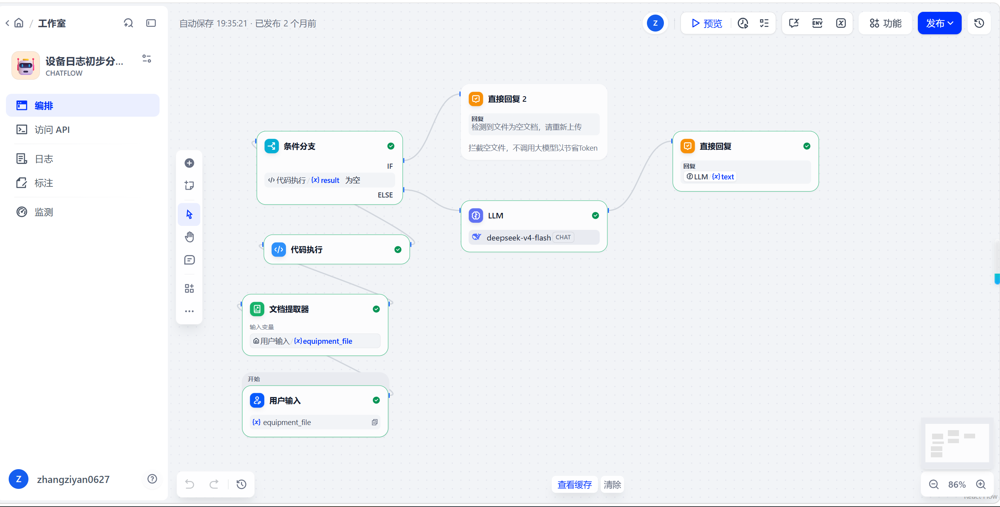

# 工业设备日志初步分析助手 (Dify Agent)

这是一个基于 **Dify** 搭建的工业级设备日志智能诊断工作流。该 Agent 专为工业/运维场景设计，接收用户上传的设备日志文件，自动提取内容，并通过严格约束的 LLM 生成高可靠性、结构化的故障排查报告。

## 💡 核心业务痛点与解决方案 (Core Features)

传统的 LLM 在处理工业日志时，常出现“胡编乱造”、“乱定故障等级”、“乱猜设备部件”等致命问题。本项目通过极其严格的 Prompt 工程与工作流节点拦截，解决了这些痛点：

1. **前置空文件与乱码拦截（省 Token & 防幻觉）**：
   - 引入“代码执行”与“条件分支”节点。若文件为空，直接拦截，不调用大模型。
   - 强制拦截乱码文件（如出现 `�`、`BCE4` 等），一旦发现编码异常，直接终止分析并提示重新上传，绝对禁止 AI 根据乱码“瞎猜”设备状态。
2. **工业级严谨表述（Prompt Engineering）**：
   - **禁止编造**：日志中没有阈值，就明确写“缺少判断阈值”；无法确认的字段写“未知”。
   - **克制定级**：没有明确的告警分级标准时，绝不使用“严重故障”等词，仅输出“疑似异常”或“疑似故障”。
   - **不瞎猜部件**：设备类型未知时，不默认存在轴承、风扇等部件；排查建议仅提供“相关监测部件”或“设备手册规定的检查项”。
3. **工单级结构化输出（Structured Output）**：
   强制 AI 按 6 个维度输出：`日志摘要`、`关键指标`、`初步判断`、`可能原因（注明依据）`、`建议排查`、`信息缺口`。输出结果可直接转化为标准运维工单。
4. **安全第一底线（Safety First）**：
   涉及人身或设备安全时，优先建议停机、断电。所有拆检、恢复运行的排查建议，均强制要求由具备资质的专业人员依据手册执行。

## 🖼️ 工作流架构 (Workflow Structure)

*工作流逻辑：用户上传文件 -> 文档提取 -> 代码节点判断是否为空/乱码 -> 条件分支（空/乱码走直接回复拦截；正常走 LLM 深度分析）。*

## 🚀 快速开始 (Quick Start)

您可以通过以下方式体验此工作流：

###导入 DSL 文件 (本地/私有化部署)
1. 下载本仓库中的 `equipment-log-agent.yml` 文件。
2. 登录您的 Dify 账号（[cloud.dify.ai](https://cloud.dify.ai) 或私有部署版）。
3. 进入“工作室”，选择 **“导入 DSL 文件”**，上传该 `.yml` 文件。
4. **⚠️ 必做步骤**：在 Dify 的“设置 -> 模型供应商”中，配置您自己的 **DeepSeek**（或对应模型）的 API Key，工作流即可正常运行。

## 📁 支持上传的文件格式
Agent 支持 Dify 文档提取器兼容的常见文本格式，包括但不限于：
- `.txt` (纯文本日志)
- `.log` (系统标准日志)
- `.csv` / `.xlsx` (导出的数据报表)
- `.json` (结构化日志)
*(注：为确保解析成功，请确保文件内容采用 `UTF-8` 编码)*

## 🛠️ 技术栈与节点 (Tech Stack)
- **平台**: Dify
- **底层模型**: deepseek-v4-flash
- **核心节点**: 用户输入、文档提取器、代码执行 (Python 正则乱码检测与空值判断)、条件分支 (IF/ELSE)、LLM、直接回复。

## 📄 License
This project is licensed under the MIT License.
